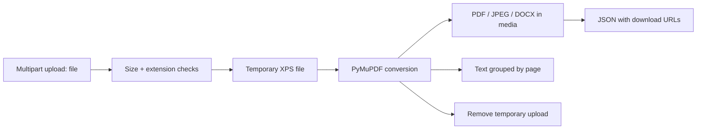

# XPS Converter · REST API

Convert an uploaded XPS document into a PDF, JPEG pages, an image-based Word document, or extracted text. Built with Django REST Framework and PyMuPDF, with a small HTTP interface for client applications.

**Python · Django · Django REST Framework · PyMuPDF · Pillow · python-docx**

[Get started](#get-started) · [API examples](docs/API.md) · [Configuration](docs/SETUP.md) · [Contribute](CONTRIBUTING.md)

## One upload format, four outputs

| Output | Endpoint | Response |
| --- | --- | --- |
| PDF | `POST /api/convert/to-pdf/` | Download URL and source page count |
| JPEG images | `POST /api/convert/to-images/` | One image URL per source page |
| DOCX | `POST /api/convert/to-docx/` | Word document containing rendered page images |
| Text | `POST /api/convert/read-text/` | Extracted text grouped by source page |

The DOCX route creates **image-based pages**, not editable reconstructed text. Text extraction reads available document text; it does not perform OCR.

## Get started

Use **Python 3.11 on Windows** as a conservative starting point for the pinned dependency set. The requirements include the Windows-specific `python-magic-bin`; other platforms need dependency adjustments.

```powershell
git clone https://github.com/Imranxhah/xps_converter_backend.git
cd xps_converter_backend
python -m venv .venv
.\.venv\Scripts\Activate.ps1
python -m pip install -r requirements.txt
python manage.py migrate
python manage.py runserver
```

Convert a local sample:

```powershell
curl.exe -X POST "http://127.0.0.1:8000/api/convert/to-pdf/" -F "file=@sample.xps"
```

The response contains a `pdf_url`; request that URL to download the result. See [API examples](docs/API.md) for all outputs and error responses.

## Conversion flow



## Defaults and behavior

| Setting | Current value |
| --- | --- |
| Maximum upload | 10 MiB |
| Maximum source pages | 100 |
| JPEG rendering | 150 DPI |
| JPEG quality | 75 |
| Output storage | `media/converted/<uuid>/` |
| Input cleanup | Temporary upload removed after the request |
| Output cleanup | No scheduled retention job is wired in |

These values are defined in [settings.py](xps_backend/settings.py). A 60-second conversion-timeout setting exists, but the conversion code does not enforce it.

## Project map

- [converter/views.py](converter/views.py): upload handling and JSON responses.
- [converter/serializers.py](converter/serializers.py): upload size/extension validation.
- [converter/utils.py](converter/utils.py): conversion, file storage, and cleanup helpers.
- [converter/urls.py](converter/urls.py): the four conversion routes.
- [xps_backend/settings.py](xps_backend/settings.py): development and conversion settings.

## Deployment notes

This is a synchronous development API. The current code does not provide authentication, rate limiting, isolated conversion workers, or an enforced execution timeout. Debug mode and permissive hosts are enabled in the checked-in settings. Address these before exposing the service to untrusted uploads.

Generated files persist until explicitly cleaned up, and local media serving relies on Django's debug configuration. See [configuration and deployment notes](docs/SETUP.md).

The cover is illustrative artwork. Conversion fidelity varies by document; inspect output with representative samples.

## Contributing

See [CONTRIBUTING.md](CONTRIBUTING.md). For conversion issues, share a minimal non-sensitive XPS sample and the expected output.

No license file is included. Contact the owner to clarify reuse terms.

Built by [Imran Shah](https://github.com/Imranxhah).
